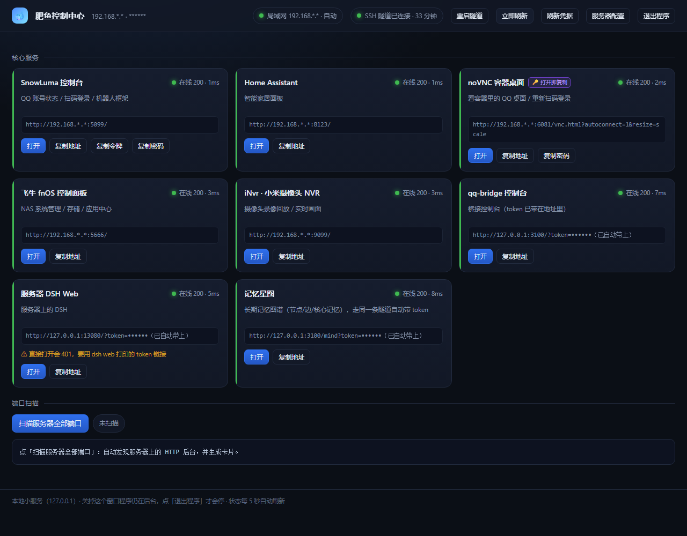

# Feiyu Hub

把散落在机器上的 Web 后台收拢到**一个页面**：NAS 面板、智能家居、远程桌面、自建工具……
手机浏览器打开 → 添加到主屏幕 → 得到一个像 App 一样的入口，点一下直达。

零依赖（只用 Node.js 内置模块），单进程，跨平台，配置全在一个 `config.json` 里。

> **🤖 全部由 AI 生成。** 这个仓库的代码、脚本、文档没有一行是人手写的——包括你正在读的这份 README。作者只负责提需求、拍板和验收，缘由见文末[「作者碎碎念」](#作者碎碎念)。



<sub>真实运行的截图：8 个服务全部在线，右侧是实时状态码与耗时。`🔑 打开即复制` 表示点「打开」时先把密钥写进剪贴板；反代卡片会标出 token 是否已自动带上。图中服务地址与账号已打码。</sub>

---

## 30 秒上手

需要 **Node.js 18+**（`node -v` 能打出版本就行）。

**Linux / NAS / 云服务器（fnOS、Debian、Ubuntu）**

```bash
tar -xzf feiyu-hub-1.0.0.tar.gz && cd feiyu-hub-1.0.0
sudo bash scripts/install.sh
```

装到 `/opt/feiyu-hub`，注册 systemd 开机自启，最后自动跑一遍自检并打印访问地址。

> 云服务器用的也是这条。装完还有两件事：**设密码**（公网上的面板一定会被扫）、在**云厂商安全组**放行面板端口。详见[「从哪儿访问」](#从哪儿访问先看装在哪再看从哪些设备看)。

**Windows**

```powershell
powershell -ExecutionPolicy Bypass -File scripts\install.ps1
```

装到 `%LOCALAPPDATA%\FeiyuHub`，桌面会多一个 `Feiyu Hub` 快捷方式。

**从源码 / git clone**

```bash
git clone https://github.com/CC6249/feiyu-hub.git && cd feiyu-hub
cp config.example.json config.json
node server.mjs
# 浏览器打开 http://127.0.0.1:18765
```

**只想先看一眼效果**（不装、不改系统）

```bash
cp config.example.json config.json
node server.mjs
# 浏览器打开 http://127.0.0.1:18765
```

> 用 AI 助手部署？把这个包丢给它，让它先读 **AGENTS.md**——那里有完整的、自包含的部署剧本和排错表。它会在动手前先问你**要从哪几条通道访问**（内网 / 组网 / DDNS / 穿透 / 云服务器，**可以多选**），别嫌啰嗦，这一步决定要不要开密码。

---

## 配置：加自己的服务

编辑安装目录下的 `config.json`，保存后访问 `http://<地址>/api/reload` 热加载（不用重启）。

最简一条——**直连**（浏览器直接访问那个端口）：

```jsonc
{
  "id": "ha",
  "name": "Home Assistant",
  "desc": "智能家居面板",
  "group": "核心",
  "accent": "amber",
  "badge": "8123",
  "type": "direct",
  "port": 8123
}
```

目标是**只监听 127.0.0.1** 的后台？用 `proxy`，Hub 帮它开一个新端口转发，顺便注入 token：

```jsonc
{
  "id": "myapp",
  "name": "我的后台",
  "group": "控制",
  "type": "proxy",
  "proxyPort": 18766,
  "upstream": { "host": "127.0.0.1", "port": 8080 },
  "inject": { "kind": "query-token", "tokenId": "myapp" }
}
```

字段全集、token 两种来源、完整 JSON 模板都在 **[AGENTS.md 的「配置服务清单」](AGENTS.md#4-配置服务清单必须问用户)**。
写错了不会崩——非法项会被跳过并记进 `warnings`，用 `verify.mjs` 或 `/api/config` 能看到。

---

## 从哪儿访问：先看装在哪，再看从哪些设备看

Hub 只负责「把服务摆到一个页面上」，**怎么把流量送到这台机器**是另一件事。要定三件事，顺序不能反。

### 一、Hub 装在哪

| 装在哪 | 直连入口 | 说明 |
|---|---|---|
| **家里的内网机器**（NAS、小主机、旧电脑、树莓派） | `http://<局域网IP>:18765` | 同一个 Wi-Fi 直接打开；出门要另加通道，见第三节 |
| **云服务器** | `http://<公网IP>:<端口>` 或域名 | **没有「局域网」这一说**——云机本身就在公网上，任何设备都能直接访问，代价是必须设密码 |

云服务器还要分两种情况，装之前先确认：

- **有公网 IP**（轻量应用服务器一般都有）→ 安全组放行面板端口就能用。
- **只有内网 IP**（VPC 里的 ECS）→ 先绑 EIP，或者用一台已有公网 IP 的机器反代过去。否则装完谁也连不上。

### 二、从哪些设备看

| 只电脑 | 只手机 | 电脑手机都要 |
|---|---|---|
| 地址丢进浏览器就行 | 必须用局域网 / 公网 IP，**不能给 `localhost`**；教「添加到主屏幕」 | 按「只手机」准备，布局是移动优先响应式，电脑端自然可用 |

三个容易踩的点：

- **手机要访问，`bind` 必须留 `0.0.0.0`**（默认值就是它）。改成 `127.0.0.1` 就只有这台机器自己打得开。
- **`http://` 下「添加到主屏幕」是快捷方式级别**：有图标、能全屏，但 Service Worker 不工作（不是安全上下文），没有离线能力。想要完整 PWA 得套 HTTPS。
- **只给手机用，别装在会关机的电脑上**。手机随时要看，宿主得是常开的（NAS、软路由、云机）。

加主屏幕的具体步骤见[「手机当 App 用」](#手机当-app-用)。

### 三、出门也要（只有装在家里才需要）

四条外网通道，**可以同时开，不是四选一**。想在家用局域网、出门用组网、再给家人一个域名，三条一起开就行，同一份 `config.json` 不用改。

| 外网通道 | 解决什么 | 需要什么 | 代价 |
|---|---|---|---|
| **A 组网（Tailscale / ZeroTier）** | 人在外面，只想自己用 | 两端各装一个客户端 | 免公网 IP、一个端口都不用开；多一层客户端，朋友用要拉进同一网络 |
| **B DDNS + 端口映射** | 想用域名访问，可能不止自己用 | **真公网 IP**（光猫/路由器能拿到） | 真正暴露在公网，**必须设密码**，最好套 HTTPS |
| **C 内网穿透（frp / cloudflared / NPS）** | 想用域名，但没有公网 IP | 一台有公网 IP 的中转机 | 流量过第三方；**必须设密码**；带宽受中转机限制 |
| **D 云服务器固定 IP** | 想要一个长期在线、地址固定的入口 | 一台云主机 | 要管证书和安全组；家里服务还得能连到云机，否则卡片全离线 |

常见组合：

| 组合 | 场景 |
|---|---|
| **家里 + A** | 最常见。在家走局域网最快，出门自动走组网，家里端口一个都不开 |
| **家里 + B** | 有公网 IP，给家人朋友一个域名，自己也用同一个 |
| **家里 + A + B** | 自己日常走组网（不经过公网），域名只留给家人朋友。注意 B 一开，公网那条路就始终存在，密码必须设 |
| **家里 + C** | 没有公网 IP（双层 NAT / 运营商大内网）但想要域名 |
| **家里 + D** | 云机做常驻入口，家里靠隧道或组网接上去 |
| **全在云上** | 不碰家里网络。Hub 和它管的服务都在云机；服务在家里就得靠隧道接过去 |

### 汇总：定下来之后改这几个配置

| 配置项 | 家里部署 | 云上部署 |
|---|---|---|
| `bind` | `0.0.0.0`（要手机访问就必须） | `0.0.0.0` |
| `auth.password` | 有外网通道就必设；纯内网 + 只电脑可以留空 | **无例外必须设**，公网上的面板一定会被扫 |
| 防火墙 | 系统防火墙放行面板端口 | **云厂商安全组**放行，只放面板端口 |
| `services` | 不用动 | 不用动；服务在家里的话要靠隧道接上云，否则卡片全离线 |

几个必须知道的点：

- **卡片地址会自动跟着走。** 用 `192.168.2.10:18765` 打开就指向 `192.168.2.10:xxxx`，用 `100.x.x.x:18765` 打开就指向 `100.x.x.x:xxxx`，用域名打开就指向域名。所以多条通道并存不需要多份配置。
- **密码是无差别的。** 设了 `auth` 之后，从局域网打开**也要输密码**——本程序不支持「内网免密、外网要密」按来源区分。
- **A 别开 Tailscale Funnel。** 那等于把面板挂到公网，跟「只有我自己能连」正好相反。
- **B 要先确认真有公网 IP。** `curl ifconfig.me` 拿到的地址和路由器 WAN 口不一致，就是在大内网里，B 走不通，改用 C。
- **B / C 先设密码，再开端口**，顺序别反。运营商普遍封 80/443，用 8443 这类高位端口。
- **D 云机只是入口。** Hub 装在云上，家里那些服务仍然要能连过去（反向隧道或两边组网），否则卡片全是离线。

> 用 AI 助手部署时，它会**先问装在哪、再问从哪些设备看、最后问要不要出门访问（可多选）**，见 [AGENTS.md 第 2 步](AGENTS.md#2-问清装在哪从哪看要不要出门安装之前必须问)。

---

## 手机当 App 用

1. 手机和这台机器能连通（在家里就同一个 Wi-Fi；装在云上就直接用公网地址）
2. 浏览器打开 `http://<这台机器的IP或域名>:18765`
3. iOS Safari：分享 → 添加到主屏幕；Android Chrome：菜单 → 添加到主屏幕

之后从桌面图标进去就是全屏，无地址栏。图标和名字可以在 `config.json` 的 `site` 段改。

> ⚠️ 用 `localhost` 加主屏幕是打不开的，必须用实际 IP 或域名。
>
> ⚠️ `http://` 下的「添加到主屏幕」是快捷方式级别：图标和全屏都有，但 Service Worker 不工作（不是安全上下文），没有离线能力。想要完整 PWA，给它套一层 HTTPS。
>
> ⚠️ 只给手机用，宿主别装在会关机的电脑上——电脑一关，手机就打不开。

---

## 安全

- **默认没有密码。** 面板把所有服务入口都摆在明面上。只在「纯内网 + 只用电脑」这种最窄的场景下可以不开；**装在云服务器上无例外必须设**——云机就在公网上，被扫到只是时间问题；家里部署只要开了任何一条外网通道也要设。设了之后内网访问同样要密码，这是 Basic Auth 的无差别行为（见上面「从哪儿访问」）。
- 需要密码就在 `config.json` 里填 `auth`，浏览器会弹原生登录框：

  ```json
  "auth": { "user": "admin", "password": "换成你的密码", "realm": "Feiyu Hub" }
  ```

  密码也可以写成 `"${HUB_PASSWORD}"`，从环境变量读，避免落盘。
- `config.json` 已在 `.gitignore` 里，别提交。
- 反代只做「本机到本机」转发，不做公网穿透。

---

## 目录结构

```
feiyu-hub-1.0.0/
├── server.mjs              主程序（零依赖，约 500 行）
├── config.example.json     配置模板，复制成 config.json 用
├── public/                 前端（PWA：index.html / sw.js / 图标）
├── docs/screenshot.png     README 里的界面截图
├── scripts/
│   ├── install.sh          Linux / NAS 一键安装（systemd）
│   ├── install.ps1         Windows 一键安装
│   ├── start.sh            前台启动（调试）
│   ├── verify.mjs          自检，输出结构化结果
│   └── uninstall.*         卸载
├── skills/feiyu-hub-deploy/  给 WorkBuddy 用的技能包（可选）
├── AGENTS.md               给 AI 的部署手册 ★
├── CLAUDE.md               Claude Code 入口（指向 AGENTS.md）
└── LICENSE                  MIT
```

---

## 常用命令

```bash
# 服务状态 / 重启 / 停
sudo systemctl status feiyu-hub
sudo systemctl restart feiyu-hub
sudo systemctl stop feiyu-hub

# 看日志
sudo journalctl -u feiyu-hub -n 60 --no-pager -o cat

# 自检
node /opt/feiyu-hub/scripts/verify.mjs

# 卸载（保留配置） / 彻底删
sudo bash /opt/feiyu-hub/scripts/uninstall.sh
sudo bash /opt/feiyu-hub/scripts/uninstall.sh --purge
```

---

## 排错

| 现象 | 多半是 |
|---|---|
| 启动就报 `EADDRINUSE` | 端口被占了，改 `config.json` 的 `port` 或某个 `proxyPort` |
| 卡片全离线 | 那些服务本身没跑，或端口填错。`curl -I http://127.0.0.1:<端口>` 自查 |
| 反代 502 | 上游没起。Hub 只负责转发，不负责把上游拉起来 |
| 反代 401 / 反复跳登录 | `tokens` 没配或路径不对。看 `curl http://127.0.0.1:18765/api/diag` 里 token 的 `len` |
| 页面改了没变化 | Service Worker 缓存。Ctrl+Shift+R，或开发者工具里注销 SW |
| 手机图标打不开 | 用了 localhost，要用局域网 IP |

更完整的排查表在 [AGENTS.md 第 6 节](AGENTS.md#6-故障--处理表)。

---

## 作者碎碎念

我以前是做 Home Assistant 智能家居集成的，那几年把 NAS 和 Docker 翻来覆去折腾了个遍。

那会儿还没有 AI 这种工具。每上一个新服务，就是复制地址、存成快捷方式、往桌面上堆；后来实在受不了，手写了一个静态跳转页，把链接一条条排进去。能用，但不好用——桌面照样乱，加个服务还得回去改页面。

这套东西的起点挺随意：最近 QQ 鲸鱼娘很火，我为了玩它，把吃灰的 NAS 又捡起来了。服务越装越多，桌面又快堆满，某天突发奇想——不如让 AI 给我写一个。

没想到还真挺好用，一直用到现在。

顺便把话说清楚：**这个项目的代码、脚本、文档全部由 AI 生成，我一行没写。** 我只负责说清楚要什么、看着不对就让它改、最后验收能不能用。你在读的这份 README、给 AI 看的 `AGENTS.md`、安装脚本和自检脚本，也都是它写的。

机器上堆着一堆后台地址这件事，估计不止我一个人烦。如果这个仓库能替你省点事，那就值了。

---

## 许可

MIT。随便改、随便分发。
